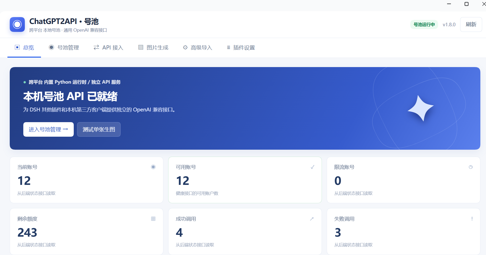
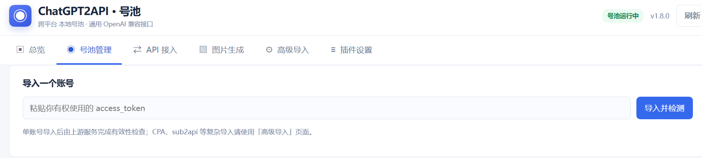

# ChatGPT2API · DSH 号池插件

在你的电脑上跑一个本地号池，并对外提供 OpenAI 兼容接口。DSH 里的其他插件、Cherry Studio 等本机软件都能直接调用，也能直接用来生图。

内置 Python 运行环境，**不用 Docker、不用自己装 Python、不用单独部署 chatgpt2api**。电脑里已经有 Python 3.13 时直接复用，没有才下载自带的轻量运行时。



## 安装：把仓库地址发给 DeepSeek 就行

复制下面这句话发给 DeepSeek（DSH）：

> 帮我安装这个插件：https://github.com/yang0/chatgpt2api-dsh

装好之后重启 DSH，左侧插件栏里就会出现 **ChatGPT2API**，点开即可使用。

第一次打开会先找系统里的 Python 3.13：找到就直接用它建隔离环境（几秒），找不到才下载自带运行时（几百 MB，请保持联网）。等顶部显示「号池运行中」就绪了，之后每次启动都是秒开。

## 第一步：直接导入账号

打开「号池管理」，账号可以直接导入，不需要额外配置 API Key：

- **单个账号**：把 `access_token` 粘贴到输入框，点「导入并检测」。
- **批量导入**：每行一条 `邮箱----密码----2FA密钥`，点「导入并授权入池」，插件会自动登录、换取 Token 并加入号池。
- 也可以直接选择一个 TXT 文件导入。



账号、密码、2FA 密钥和 Token 都只保存在你自己的电脑上，不会上传到任何第三方；密码与 2FA 密钥不会在页面回显。

## 第二步：给其他软件用

打开「API 接入」，点一下生成用户 API Key，然后把这两个值填到你的软件里：

- **API Base URL**：`http://127.0.0.1:38650/v1`
- **API Key**：`Bearer 你刚生成的 Key`

支持 `models`、`chat/completions`、`responses`、`images/generations`、`images/edits` 这些常用接口，Cherry Studio 等客户端可以直接连。

## 第三步：直接生图

打开「图片生成」，输入提示词就能出图；也可以上传最多 4 张参考图做图片编辑。

成功后图片会自动按日期保存到本机，页面里可以一键打开历史图片文件夹。如果提示词被上游安全策略拒绝（例如「写真」「身体特写」类描述），换一种更安全的说法即可，界面会给出改写建议。

## 原生 GIF 动画生成

「图片生成」页面增加 **动图 GIF** 开关、帧数（2–16）与每帧时长（20–2000 毫秒，按 10ms 递增）。生成成功后可以直接预览并下载 `.gif`。

**重要：** 当前 `basketikun/chatgpt2api` 的最新固定源码版本（`92dd80e`）尚未实现 GIF API。DSH 插件为原生 GIF 单独接入了官方 OpenAI Images API，而不是将静态帧合成为动画。启用这一通道需要单独的 **OpenAI API Key**，可能产生 API 费用；原来的 ChatGPT 账号池凭据不能替代官方 API Key。不要把 API Key 粘贴到提示词或公开仓库。

在启动 DSH 的 **Host 进程环境**中设置 `DSH_OPENAI_GIF_API_KEY`，随后完整重启 DSH 和它托管的 Python 后端。插件不会把该 Key 传回浏览器或第三方客户端；没有设置时 GIF 请求会明确报错，静态 PNG/JPEG 号池生图仍可使用。仅托管后端支持此功能；外部独立后端不受插件控制。

第三方软件可向 `POST http://127.0.0.1:38650/v1/images/generations` 发送：

```json
{
  "model": "gpt-image-2",
  "prompt": "一只卡通小猫摇尾巴，镜头固定，动作平滑循环",
  "output_format": "gif",
  "frame_count": 9,
  "frame_duration_ms": 200,
  "size": "auto"
}
```

返回 `data[0].b64_json` 为 GIF Base64，可解码保存为 `.gif`。该通道只实现 `/v1/images/generations` 原生 GIF；参考图片、图片编辑 GIF、流式结果暂不支持。部分模型可能没有 GIF 预览权限或对尺寸、总像素有进一步限制，以上请求不保证所有账号都成功。

## 默认生图模型与 1K / 2K / 4K 分辨率

在左侧「图片生成」中，点击「刷新模型」获取后端当前公布的模型列表，选择模型及分辨率档位（自动 / 1K / 2K / 4K），点击「保存为默认」。配置保存在本机 DSH 数据目录的 `image-preferences.json` 中，**不保存图片比例**。

当第三方软件调用插件托管的本地后端 `http://127.0.0.1:38650/v1` 时，以下图片接口也会读取相同默认值：

- `POST /v1/images/generations`（JSON 文生图）
- `POST /v1/images/edits`（JSON 或 multipart 图片编辑）
- `POST /v1/responses` 中带 `image_generation` 工具的请求

例如默认档位设为 **2K** 时：

```json
{
  "model": "gpt-image-2",
  "prompt": "一张 16:9 的风景图"
}
```

插件在缺少 `size` 时根据比例补成类似 `2560x1440` 的目标尺寸，向上游请求；用户也可以传 `"aspect_ratio": "9:16"`，或者在提示词中写明 `1:1`、`16:9`、`9:16` 等支持的比例。若调用方**显式传入 `size`**，则始终优先使用其尺寸，不被保存的档位覆盖。没有给出可识别的比例时，插件不会擅自保存或猜测比例，也不能保证自动得到 2K/4K。最终分辨率仍受账号、模型和上游支持范围限制，并非所有 4K 组合一定成功。

**生效范围：** 上述第三方默认值功能仅适用于本插件**托管**的本机 Python 后端，且需要由新版插件启动的后端进程；设置 `DSH_CHATGPT2API_URL` 指向外部独立后端时不生效。升级前已在端口 38650 运行的旧版后端如果被 DSH 接管，需先正常停止旧后端进程，再启动新版插件，才能启用新的 API 入口；仅重开管理面板不足以替换运行中的进程。当前 `/v1/chat/completions` 的图片兼容路由未纳入这一默认尺寸机制。

## 功能一览

- **总览**：账号总数、可用账号、剩余额度、成功/失败调用。
- **号池管理**：单账号导入、邮箱批量导入并自动授权、待授权记录、账号检测与删除。
- **API 接入**：创建/重置/吊销第三方调用 Key，复制 Base URL。
- **图片生成**：文生图、参考图编辑、历史图片目录。
- **高级导入**：CPA、sub2api 账号来源。
- **插件设置**：运行环境检查与排障。

## 常见问题

**账号导入成功，但总额度始终是 0？**

这可能是额度查询的网络问题，不能仅凭登录成功就认定可生图：OAuth 登录走 `auth.openai.com`，额度与图片相关请求走 `chatgpt.com`，两者可能采用不同网络路径。

1. 在「号池管理」→「代理与额度排障」中输入你本机实际的 HTTP(S)/SOCKS5 代理地址（例如 `http://127.0.0.1:7897`，仅是示例；以代理软件显示的端口为准）。
2. 点击「测试代理连通性」，通过后点击「保存全局代理」。**代理软件需要保持运行**。
3. 点击「全部刷新额度」，等待任务显示完成，再查看账号状态与额度。测试 HTTP 200 只能证明代理连通，不能证明账号实际有额度。
4. 如果仍是 0，可点击「复制排查说明给 DeepSeek」，让其核对直连/代理、网络日志、刷新结果与账号权限。不要将账号密码、2FA 密钥、Token 发给别人，也不要直接修改数据库额度来掩盖问题。

插件只通过 DSH 已认证的 Host 接口保存全局 `proxy` 字段，不暴露后端完整 settings。外部后端的代理配置由对应后端自行管理。代理不支持在页面填写带账号密码的 URL。

**第一次打开显示「后端未就绪」？**
首次需要下载运行环境，耐心等几分钟；也可以到「插件设置」查看当前状态。

**生图报 400 / 提示内容政策？**
这是上游的安全策略，不是插件或账号坏了。换掉「真人 / 写真 / 性感 / 身体特写」这类描述，改用插画、水彩、景物或虚构角色即可。

**切换插件或会话回来，页面会重置吗？**
不会。当前标签页、输入草稿、生成结果和滚动位置都会保留。

**数据存在哪里？**
都在你的用户目录下（Windows：`%USERPROFILE%\.dsh\chatgpt2api-native\`；macOS/Linux：`~/.dsh/chatgpt2api-native/`）。升级或重装前备份这个目录即可。

**后端挂了或一直「未就绪」怎么办？**
正常情况下插件会自己处理：进程意外退出会自动重启（最多 3 次）；上次 DSH 崩溃残留的后端会被直接接管；Python 依赖被清理或杀软删掉时会自动重装依赖。仍然异常时，在插件仓库目录执行：

```bash
npm run check    # 检查解释器、site-packages 与关键依赖是否齐全
npm run repair   # 就地修复运行环境（不启动服务）
npm run diagnose # 查看后端日志尾部
```

**系统 Python 相关**
- 插件要求 **Python 3.13**（后端锁文件 `requires-python >= 3.13`）；3.12 及更早不会被选中。
- 优先顺序：Windows 的 `py -3.13` / 注册表登记的安装 → `python3.13` → 其他 PATH 候选 → uv 找到的解释器 → 自带运行时。**跑在其他工具虚拟环境里的 Python 不会被选中**，避免绑到别人随时会删的环境。
- 想指定解释器：设置 `DSH_CHATGPT2API_PYTHON` 指向具体 `python.exe`。
- 依赖默认装在隔离 venv 里；确实需要复用全局包（例如全局 CUDA 轮子）时设 `DSH_CHATGPT2API_SYSTEM_SITE_PACKAGES=1`。

## 安全与合规

- 请只导入你本人有权使用的账号，并遵守上游平台的使用规则。
- 本插件不售卖、不代购账号，也不提供账号共享。
- 账号池、密钥与日志都只保存在本机；管理页面不需要额外密码，靠 DSH 已登录会话鉴权。
- chatgpt2api 属于对网站接口的逆向研究，可能随上游变化而失效。
